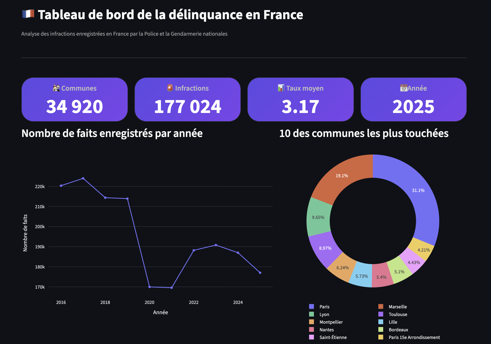
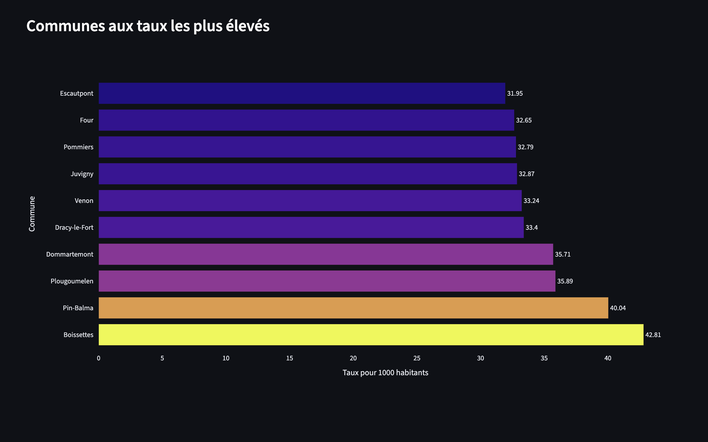

# 📊 Crime Statistics France

Dashboard interactif d'analyse de la délinquance en France à partir des données officielles de Data.gouv.fr.

## 🚀 Aperçu

Cette application permet d'explorer les statistiques de criminalité en France grâce à des visualisations interactives construites avec Streamlit et Plotly.

Les données sont stockées dans PostgreSQL (Neon) puis exploitées dans un tableau de bord web permettant de filtrer les résultats par année et type d'infraction.

## 🔗 Démo

**Application en ligne :**  
https://crime-statistics-france-pa5jxf48idncegfkuazgwi.streamlit.app/

**Code source :**  
https://github.com/Alpha38diallo/Crime-statistics-france

---

## 📸 Aperçu de l'application

### Vue générale



### Communes aux taux les plus élevés



---

## 🛠️ Technologies utilisées

- Python
- Pandas
- PostgreSQL
- Neon Database
- SQLAlchemy
- Streamlit
- Plotly
- Git
- GitHub

---

## 📂 Architecture du projet

```text
Données Data.gouv.fr
        │
        ▼
    Python ETL
        │
        ▼
 PostgreSQL (Neon)
        │
        ▼
 Streamlit Dashboard
        │
        ▼
 Graphiques interactifs
```

---

## 📈 Fonctionnalités

- Analyse des statistiques de criminalité en France
- Filtrage par année
- Filtrage par type d'infraction
- Classement des communes
- Visualisations interactives avec Plotly
- Indicateurs clés de performance (KPI)
- Analyse comparative des taux de criminalité
- Exploration des données par commune

---

## ⚠️ Limitation connue

Le graphique présentant l'évolution du nombre de faits enregistrés par année a été temporairement désactivé dans la version déployée sur Streamlit Community Cloud. La base de données contient plus de 5 millions d'enregistrements et le volume de données dépasse les ressources disponibles sur l'environnement d'hébergement.

Les captures d'écran ci-dessus illustrent certaines fonctionnalités développées pour le projet. Une future optimisation des requêtes SQL et de la mise en cache permettra d'améliorer les performances et d'étendre les visualisations disponibles.

---

## 📊 Données

**Source :** Data.gouv.fr

Les données proviennent des statistiques officielles de la délinquance enregistrée par les services de police et de gendarmerie en France.

---

## ⚙️ Installation locale

### Cloner le projet

```bash
git clone https://github.com/Alpha38diallo/Crime-statistics-france.git
cd Crime-statistics-france
```

### Créer un environnement virtuel

```bash
python -m venv venv
```

### Activer l'environnement

#### macOS / Linux

```bash
source venv/bin/activate
```

#### Windows

```bash
venv\Scripts\activate
```

### Installer les dépendances

```bash
pip install -r requirements.txt
```

### Configurer les variables d'environnement

Créer un fichier `.env` :

```env
DB_HOST=your_host
DB_NAME=your_database
DB_USER=your_user
DB_PASSWORD=your_password
DB_PORT=5432
```

### Lancer l'application

```bash
streamlit run dashboard/app.py
```

---

## 🗄️ Base de données

La base de données PostgreSQL est hébergée sur Neon.

Les données sont chargées via un pipeline ETL Python puis stockées dans la table :

```text
crime_stats
```

Des index SQL ont été ajoutés afin d'améliorer les performances des requêtes.

---

## 🎯 Compétences démontrées

- Data Analysis
- Data Cleaning
- ETL Processing
- SQL
- PostgreSQL
- Data Visualization
- Dashboard Development
- Git Version Control
- Cloud Database Integration
- Streamlit Deployment

---

## 👨‍💻 Auteur

**Alpha Diallo**

🎯 Objectif professionnel : **Data Engineer Junior / Data Analyst**

**GitHub :**  
https://github.com/Alpha38diallo